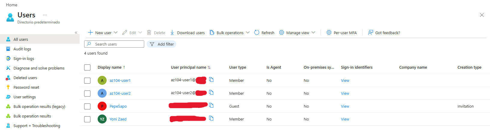
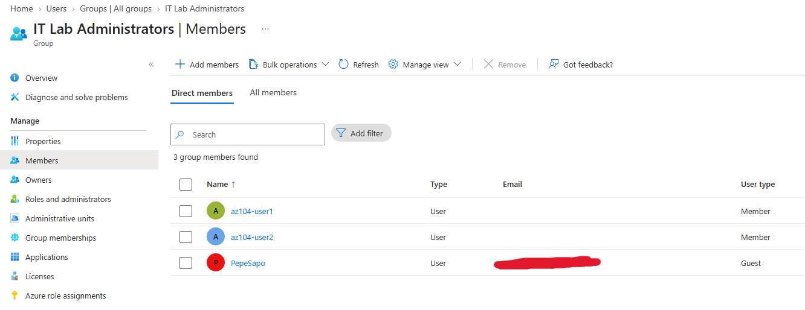
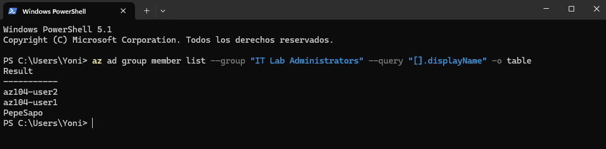

# Lab 01 – Manage Microsoft Entra ID Identities

Part of my [AZ-104: Microsoft Azure Administrator](https://learn.microsoft.com/en-us/credentials/certifications/azure-administrator/) study portfolio.
Based on the official [Microsoft Learning lab](https://microsoftlearning.github.io/AZ-104-MicrosoftAzureAdministrator/Instructions/Labs/LAB_01-Manage_Entra_ID_Identities.html).

## Objective

Create and manage identities in Microsoft Entra ID: internal users, an external guest user and a security group, first in the portal and then with the Azure CLI.

## Environment

| Item | Value |
|---|---|
| Tenant | Personal Microsoft Entra ID tenant |
| Tools | Microsoft Entra admin center (Azure portal), Azure CLI |
| Cost | None (Entra ID objects only, no Azure resources) |

## What I did

| Step | Method | Result |
|---|---|---|
| 1 | Portal | Created internal user `az104-user1` (job title *IT Lab Administrator*, department *IT*) |
| 2 | Portal | Invited an external user as a **guest** (B2B) and accepted the invitation |
| 3 | Portal | Created the **security** group `IT Lab Administrators` with **assigned** membership, set myself as owner and added both users |
| 4 | Azure CLI | Created a second user, `az104-user2`, and added it to the same group |
| 5 | Azure CLI | Verified the group members |

## Key commands

See [`scripts/lab01.ps1`](scripts/lab01.ps1).

```powershell
az ad user create --display-name az104-user2 --user-principal-name "az104-user2@$domain" --password "<secure-password>"
$id = az ad user show --id "az104-user2@$domain" --query id -o tsv
az ad group member add --group "IT Lab Administrators" --member-id $id
az ad group member list --group "IT Lab Administrators" --query "[].displayName" -o table
```

## Screenshots

**Users in the tenant:** two internal members and one guest.



**Group members:**



**Verification with the Azure CLI:**



## Key takeaways

- **User types:** *members* are internal identities created in the tenant; *guests* are external users invited through B2B collaboration, with their own credentials.
- **Group types:** *security* groups grant access to resources; *Microsoft 365* groups add collaboration features (mailbox, Teams, SharePoint).
- **Membership types:** *assigned* membership is managed manually; *dynamic* membership uses rules on user attributes and requires Entra ID P1 or P2.
- **Object IDs:** the CLI adds members to a group by object ID, not by display name, so the ID has to be looked up first.
- **Personal vs. work accounts:** a personal Microsoft account can administer Azure and Entra ID, but the Microsoft 365 admin center requires a work or school account.